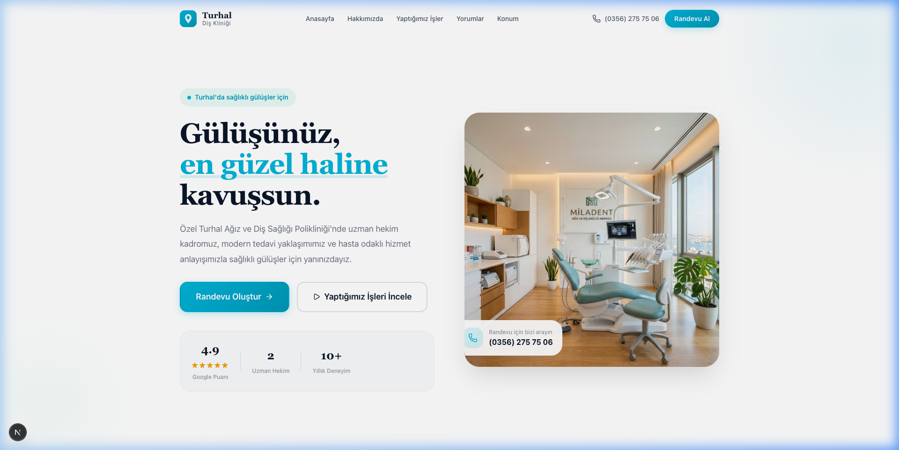
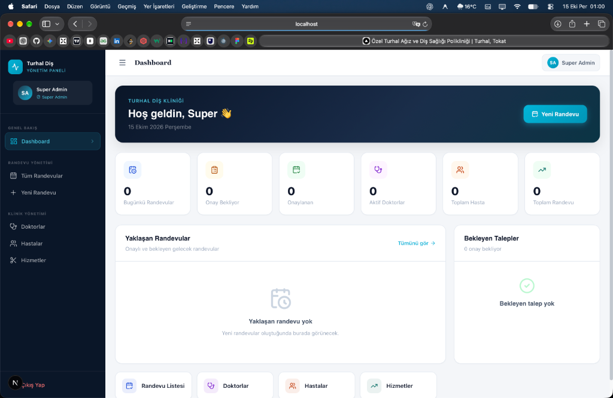
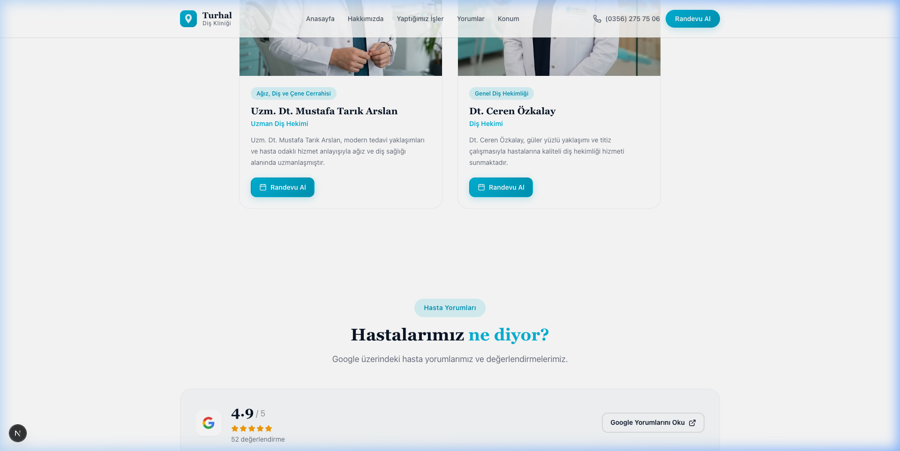
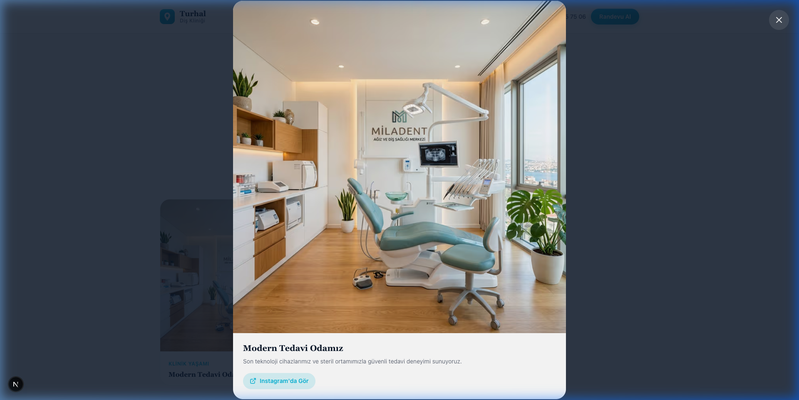
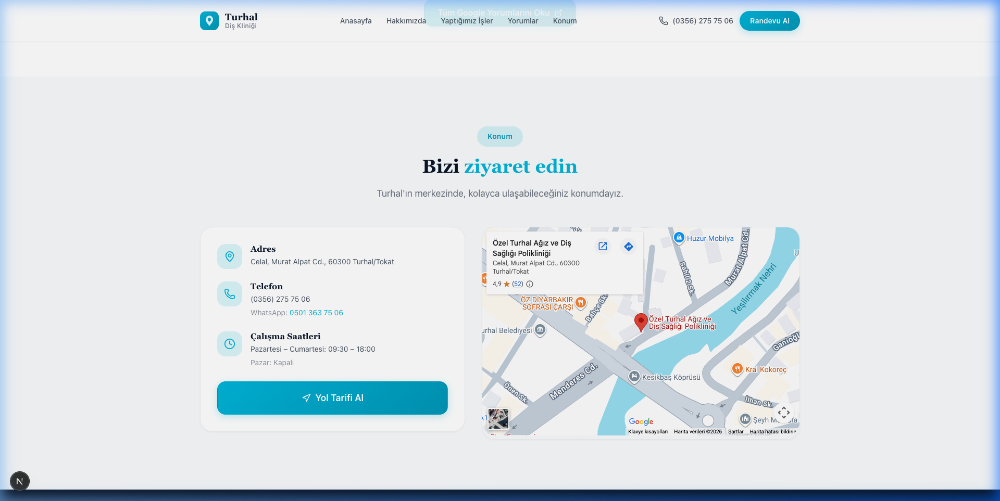

# 🦷 Özel Turhal Ağız ve Diş Sağlığı Polikliniği (V2)

<p align="center">
  
</p>

<p align="center">
  
  
  
  
  
  
  
</p>

---

## 📌 Proje Hakkında

**Özel Turhal Ağız ve Diş Sağlığı Polikliniği V2**, modern sağlık teknolojileri ve kullanıcı dostu arayüz tasarımı ilkeleriyle geliştirilmiş kapsamlı bir klinik web platformu ve yönetim sistemidir. 

Platform, ziyaretçilere hekim seçimi ve gerçek zamanlı randevu alma imkânı sunmanın yanı sıra; klinik yöneticileri (**Super Admin**) ve hekimler (**Doktorlar**) için rol bazlı, çakışma önleyici akıllı motorla donatılmış profesyonel bir **Yönetim Paneli (Admin Portal)** sağlar.

---

## ✨ Öne Çıkan Özellikler

### 1. 🏥 Profesyonel Yönetim & Doktor Paneli (Admin Portal)
* **👑 Kapsamlı Super Admin Paneli (`/admin`):**
  * **Anlık Klinik Kokpiti:** Bugünkü randevular, onay bekleyen talepler, aktif doktorlar, toplam hasta ve randevu istatistikleri.
  * **Uçtan Uca Randevu Yönetimi:** Tüm hekimlerin randevularını filtreleme, detayları inceleme, yeni randevu oluşturma, onaylama, iptal etme, tamamlama ve silme.
  * **Hekim ve Müsaitlik Yönetimi:** Yeni doktor hesabı tanımlama, haftalık çalışma saatleri (`DoctorAvailability`) ve tatil/izin gibi kapalı zaman aralıkları (`DoctorBlockedTime`) belirleme.
  * **Hasta ve Hizmet Portföyü:** Kayıtlı hasta listesi, geçmiş randevu takibi ve sunulan klinik tedavi hizmetlerinin yönetimi.
* **🩺 Yetki Sınırlandırılmış Doktor Paneli (`/admin/doktor`):**
  * Hekimler yalnızca kendi randevularını ve hastalarını görebilir; diğer hekimlerin verilerine kesinlikle erişemez.
  * Kendilerine atanan randevuları liste veya detay görünümünde inceleme, bekleyen talepleri onaylama/reddetme veya tamamlandı olarak işaretleme.
* **🛡️ Güçlü Sunucu Tarafı Güvenlik & Yetkilendirme:**
  * **Auth.js (NextAuth v5)** ve **bcryptjs** ile güçlendirilmiş güvenli kimlik doğrulama.
  * Next.js Middleware ve API seviyesinde çok katmanlı rol doğrulama (`SUPER_ADMIN` vs `DOCTOR`).
* **⚡ Akıllı Randevu Çakışma Önleme (Conflict Prevention):**
  * `PENDING` (Onay Bekliyor) ve `CONFIRMED` (Onaylandı) randevular ilgili zaman dilimini otomatik olarak kilitler; aynı hekime çakışan randevu oluşturulamaz.
  * `CANCELLED` (İptal Edildi) durumundaki randevular ilgili saat dilimini derhal tekrar müsait hâle getirir.

---

### 2. 📅 Gerçek Zamanlı Online Randevu Sistemi (Hasta Arayüzü)
* **Hekim Bazlı Randevu Seçimi:** Ziyaretçiler kliniğimiz hekimleri arasından seçim yapabilir ve hekime özel takvimi görüntüleyebilir.
* **⚡ Doktorsitesi.com Canlı Takvim Senkronizasyonu:** Dt. Yakup Aşar'ın Doktorsitesi takvimi ile 30 dakikada bir otomatik senkronize olan ve anlık kontenjan boşalmalarını anında yakalayan optimize edilmiş API mimarisi.
* **🕒 Akıllı Saat Yönetimi:** Bugün için saati geçmiş randevu aralıkları otomatik filtrelenir ve kullanıcıların geçmiş zamana rezervasyon yapması engellenir.
* **🔍 Aranabilir Çoklu Hizmet Seçimi:** İmplant, Zirkonyum, Diş Beyazlatma, Kanal Tedavisi gibi tedavi türlerini arayarak birden fazla seçim yapabilme.
* **💬 WhatsApp Teyit & KVKK Entegrasyonu:** Randevu başarıyla tamamlandığında tek dokunuşla WhatsApp üzerinden kliniğe teyit mesajı iletebilme.

---

### 3. 🌟 Hasta Yorumları & Google Deneyimi
* Google Review derecelendirmeleri, filtreleme sekmeleri (Tümü, Diş Beyazlatma, İmplant vb.) ve `/yorumlar` detay sayfası.
* Güven tescilleyen hasta puanlama rozetleri ve dinamik yıldız bileşeni.

---

### 4. 🎨 Modern Tasarım Dili (Klinik Teması)
* Kliniğin kurumsal kimliğine uygun derin lacivert (`#0a1628`), okyanus turkuazı (`#00b4d8`) ve nane tonları.
* Sayfa kaydırma ile devreye giren dinamik şeffaf / buzlu cam (frosted glass) Navbar.
* Mobil, tablet ve masaüstü uyumlu (Fully Responsive) ve erişilebilir kullanıcı deneyimi.

---

## 📸 Arayüz Vitrini

### 🔹 Yönetim Paneli (Super Admin Dashboard)
<p align="center">
  
</p>

### 🔹 Ziyaretçi & Hasta Deneyimi
<div align="center">
  <table>
    <tr>
      <td width="50%">
        
        <p align="center"><b>Modern Anasayfa ve Karşılama Alanı</b></p>
      </td>
      <td width="50%">
        
        <p align="center"><b>Uzman Kadro ve Hasta Değerlendirmeleri</b></p>
      </td>
    </tr>
    <tr>
      <td width="50%">
        
        <p align="center"><b>Klinik ve Tedavi Galerisi</b></p>
      </td>
      <td width="50%">
        
        <p align="center"><b>Google Harita & Çalışma Saatleri</b></p>
      </td>
    </tr>
  </table>
</div>

---

## 🛠️ Teknoloji Yığını

* **Framework:** [Next.js 16 (App Router)](https://nextjs.org/)
* **Kütüphane:** [React 19](https://react.dev/)
* **Veritabanı & ORM:** [MySQL](https://www.mysql.com/) & [Prisma ORM](https://www.prisma.io/)
* **Kimlik Doğrulama:** [Auth.js / NextAuth.js v5](https://authjs.dev/) & [bcryptjs](https://www.npmjs.com/package/bcryptjs)
* **Derleme Aracı:** Next.js Turbopack
* **Stil & Tasarım:** CSS Modules, Modern CSS Custom Properties (Design Tokens)
* **İkonlar:** [Lucide React](https://lucide.dev/)
* **Entegrasyonlar:** Doktorsitesi.com API, Google Maps Embed API, WhatsApp Business Link Generator

---

## 📁 Proje Mimarisi

```text
├── prisma/
│   ├── migrations/            # Veritabanı şema versiyonları
│   └── schema.prisma          # Veritabanı modelleri (User, Doctor, Patient, Appointment vb.)
├── public/                    # Statik varlıklar (görseller, hekim fotoğrafları, logolar)
├── scripts/
│   └── create-admin.mjs       # Güvenli CLI Super Admin oluşturma aracı
├── showcase/                  # Tanıtım ekran görüntüleri
├── src/
│   ├── app/
│   │   ├── (auth)/login/      # Admin giriş sayfası
│   │   ├── admin/             # Super Admin sayfaları (Dashboard, Randevular, Doktorlar, Hastalar, Hizmetler)
│   │   │   └── doktor/        # Doktor yetkili özel randevu takip alanı
│   │   ├── api/
│   │   │   ├── admin/         # Yönetim API rotaları (CRUD ve durum güncellemeleri)
│   │   │   ├── appointments/  # Hasta arayüzü randevu servisleri
│   │   │   └── auth/          # NextAuth kimlik doğrulama rotaları
│   │   ├── randevu/           # Online randevu rezervasyon sihirbazı
│   │   ├── yorumlar/          # Hasta değerlendirmeleri detay sayfası
│   │   ├── globals.css        # Tipografi, tema ve renk değişkenleri
│   │   ├── layout.js          # Kök düzen
│   │   └── page.js            # Ana karşılama sayfası
│   ├── components/
│   │   ├── admin/             # Admin sidebar, topbar, profil ve randevu bileşenleri
│   │   ├── Appointment/       # Randevu adımları ve hekim seçimi
│   │   ├── Hero/              # Hero alanı
│   │   ├── Navbar/            # Dinamik menü çubuğu
│   │   └── Footer/            # Alt bilgi ve iletişim
│   ├── config/
│   │   └── clinic.js          # Klinik merkezi yapılandırması
│   ├── lib/
│   │   ├── adminAuth.js       # Yetkilendirme ve çakışma kontrol motoru
│   │   └── prisma.js          # Singleton Prisma veritabanı istemcisi
│   ├── auth.js                # Auth.js yapılandırması ve credentials sağlayıcısı
│   └── middleware.js          # Rota bazlı yetki kontrol middleware'i
```

---

## 🚀 Başlangıç ve Yerel Kurulum

Projeyi yerel ortamınızda çalıştırmak için aşağıdaki adımları takip edebilirsiniz:

### Gereksinimler
* [Node.js](https://nodejs.org/) (v18.18 veya üzeri önerilir)
* [MySQL](https://www.mysql.com/) (v8.x veya üzeri)
* [Git](https://git-scm.com/)

### 1. Depoyu Klonlayın
```bash
git clone https://github.com/BurhanAlperen/dental_clinic.git
cd dental_clinic
```

### 2. Bağımlılıkları Yükleyin
```bash
npm install
```

### 3. Ortam Değişkenlerini Yapılandırın
`.env.example` dosyasını referans alarak `.env.local` oluşturun ve bilgilerinizi girin:
```bash
cp .env.example .env.local
```

### 4. Veritabanını Hazırlayın
Prisma migration'larını veritabanına uygulayın ve Prisma istemcisini oluşturun:
```bash
npx prisma migrate dev
npx prisma generate
```

### 5. İlk Super Admin Hesabını Oluşturun
```bash
node scripts/create-admin.mjs
```

### 6. Geliştirme Sunucusunu Başlatın
```bash
npm run dev
```

* **Web Sitesi:** [http://localhost:3000](http://localhost:3000)
* **Yönetim Paneli:** [http://localhost:3000/admin](http://localhost:3000/admin)

---

## 📡 API Uç Noktaları

### 🌐 Genel API'ler
| Yöntem | Endpoint | Açıklama |
| :--- | :--- | :--- |
| `GET` | `/api/appointments` | Randevu takvimi ve dolu saatleri listeler |
| `POST` | `/api/appointments` | Yeni randevu rezervasyonu oluşturur |
| `GET` | `/api/appointments/doktorsitesi` | Doktorsitesi takvimini çeker (30 dk cache) |
| `GET` | `/api/reviews` | Google Places veya statik hasta yorumlarını getirir |

### 🔒 Yönetim (Admin) API'leri
| Yöntem | Endpoint | Yetki | Açıklama |
| :--- | :--- | :--- | :--- |
| `GET / POST` | `/api/admin/appointments` | Admin / Doktor | Randevuları listeleme ve filtreleme / Yeni randevu açma |
| `GET / PATCH / DELETE` | `/api/admin/appointments/[id]` | Admin / Doktor | Randevu detayı, durum güncelleme ve iptal |
| `GET / POST` | `/api/admin/doctors` | Super Admin | Hekim listesi ve yeni doktor hesabı tanımlama |
| `GET / PATCH / DELETE` | `/api/admin/doctors/[id]` | Super Admin | Hekim profili güncelleme ve arşivleme |
| `GET / PUT` | `/api/admin/doctors/[id]/availability` | Super Admin | Haftalık çalışma saatlerini düzenleme |
| `GET / POST` | `/api/admin/doctors/[id]/blocked-times` | Super Admin | İzin/tatil kapalı zaman aralıkları tanımlama |
| `GET` | `/api/admin/patients` | Super Admin | Kayıtlı hasta veritabanı ve geçmiş randevuları |
| `GET / POST` | `/api/admin/services` | Super Admin | Tedavi hizmetleri listesi ve yeni hizmet ekleme |

---

## 📄 Lisans

Bu proje **MIT Lisansı** altında lisanslanmıştır. Detaylar için [LICENSE](LICENSE) dosyasına göz atabilirsiniz.

Copyright © 2026 **Burhan Alperen Divarcı**. Tüm hakları saklıdır.
